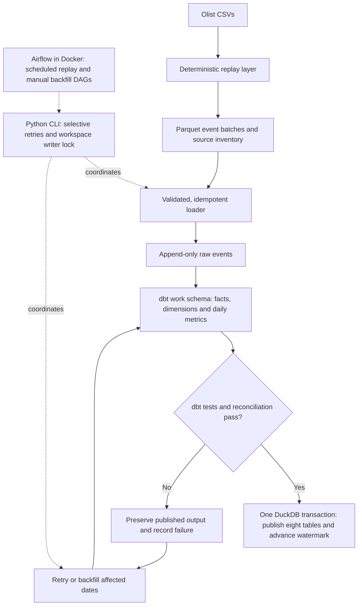

# OrderLedger

**An incremental analytics warehouse for trustworthy order and delivery metrics.**

OrderLedger models 99,441 e-commerce orders with **Python, SQL, dbt and DuckDB**. It handles duplicate events, corrections and late arrivals, checks the resulting metrics, and publishes them only when validation passes. Failed runs preserve the last successful output; targeted backfills repair stale reporting dates.

Built as a personal project on the public Olist dataset, it demonstrates dimensional modelling, incremental transformations, data-quality gates and recovery from failed runs.

[Evidence report](docs/evidence-report.md) · [Data model](docs/data-model.md) · [Demo transcript](docs/demo-transcript.txt) · [CI](https://github.com/binoy-sasmal/orderledger/actions)

## Verified results

Recorded full-data runs on 6 November 2026:

| Check | Result |
|---|---|
| Input | 99,441 orders; 643,721 event records, including labelled synthetic changes and duplicates |
| Incremental processing versus full replay | Zero differing rows across all eight published tables after required backfills |
| Different batch boundaries | The 56-batch and 28-batch runs produced identical final tables |
| Business metrics | Order counts, gross merchandise value, delivered counts and on-time counts matched both a Python reference and, on the unmodified source scenario, direct SQL over the CSVs |
| Late corrections | Reconciliation identified stale dates and blocked publication; targeted backfills repaired them |
| Automated checks | 35 tests passed locally and in GitHub Actions on synthetic fixtures when first recorded; the suite now has 56 tests locally |
| Orchestration (synthetic fixture only) | Local Airflow 3.4.0 ran scheduled replay batches, retried an injected transient failure, refused to retry deterministic reconciliation failures, repaired stale dates through a parameterised backfill DAG, and serialized overlapping writers. Final tables equalled a single-pass replay. See [orchestration evidence](docs/orchestration-evidence.md) |

The [evidence report](docs/evidence-report.md) links to recorded results, explains the scenarios and reports measured runtimes. These results demonstrate correctness under the tested conditions; they do not establish a performance advantage for incremental processing.

## Architecture



A Python CLI coordinates loading, dbt builds, validation and publication. The raw history remains available for replay, while the `published` schema contains the last successfully validated result. See the [architecture](docs/architecture.md) and [transaction guarantees](docs/guarantees.md).

## Engineering decisions

- **Recompute changed orders from their full history.** New events identify affected keys; rebuilding those keys from retained history makes results independent of arrival order and batch boundaries.
- **Separate purchase and delivery reporting.** Order and item facts, customer/product/date dimensions and lifecycle intervals feed separate daily purchase and delivery aggregates. Each metric has an explicit population, denominator and time basis. See the [model](docs/data-model.md) and [metric definitions](docs/metrics.md).
- **Make late-data recovery explicit.** Aggregates use a seven-day lookback plus affected new dates. Corrections that leave older dates stale fail reconciliation and identify the dates to backfill. See the [late-data walkthrough](docs/late-data.md).
- **Publish atomically after validation.** dbt tests and source-to-fact-to-metric reconciliation run before all published tables and the watermark are updated in one DuckDB transaction. A failed build or publication attempt preserves the previous output.
- **Cross-check through different paths.** A source inventory checks expected event counts, a Python reference checks headline metrics, and direct SQL over the source CSVs checks the unmodified-data scenario. The reference shares authorship with the warehouse; the CSV comparison bypasses the event replay layer.
- **Keep source anomalies visible.** Inconsistent lifecycle timestamps are flagged and excluded from delivery metrics instead of silently repaired. Customer and product dimensions use Type 1 updates; the source does not justify claiming verified customer address history.

## Data and scope

Olist contains historical order snapshots and lifecycle timestamps, not a live change feed. The replay layer derives events from those fields. **Arrival times and batch membership are simulated; duplicates, corrections, deletions and delayed arrivals are synthetic and labelled.** Cancellation remains an observed status, without an invented cancellation time. See the [event contracts](docs/contracts.md).

The implemented warehouse runs locally on DuckDB. Local Airflow orchestration (scheduling, retries, targeted backfill, single-writer protection) is implemented and was verified on the synthetic fixture, not on the full Olist data; cloud-platform execution is not implemented. The single-writer publication guarantees are specific to this implementation. At the measured dataset size, a full replay was faster than a typical incremental batch; runtime details and remaining gaps are documented in the [evidence report](docs/evidence-report.md) and [gap mapping](docs/gap-mapping.md).

## Run the project

Requires Python 3.12 and [uv](https://docs.astral.sh/uv/). Run commands from the repository root.

```sh
uv sync --frozen
uv run pytest
```

The tests use synthetic fixtures and require no Olist download or credentials. GitHub Actions runs lint and the test suite on pushes to `main` and pull requests.

### Walk through failure and recovery

```sh
uv run python scripts/demo.py
```

The script demonstrates a normal run, an injected failure and retry, a late correction, a targeted backfill and reconciliation. It recreates its dedicated `warehouse/demo` directory on each run. A recorded [demo transcript](docs/demo-transcript.txt) is available without running the project.

### Orchestrate with Airflow (local, Docker)

Requires Docker Desktop. Uses the synthetic fixture, so no Kaggle login is needed.

```sh
uv run python airflow/demo.py
```

The script rebuilds a local Airflow 3.4.0 stack from scratch (generated secrets, image pinned by digest), runs scheduled replay batches, injects a transient failure that Airflow retries, shows a reconciliation failure that is not retried, repairs it through the backfill DAG, and checks 23 outcomes (about 20 minutes). Design, scope and limits: [docs/orchestration.md](docs/orchestration.md).

### Run on the full Olist dataset

Follow the [data acquisition instructions](docs/data-acquisition.md), then:

```sh
uv run orderledger check-data data/olist
uv run orderledger simulate data/olist --scenario scenarios/ci.yml --ws warehouse/main
uv run orderledger run --ws warehouse/main --through 1
uv run orderledger status --ws warehouse/main
uv run orderledger reconcile --ws warehouse/main
```

Advance `--through` to process later batches. If reconciliation reports stale dates, repair the loaded history with:

```sh
uv run orderledger backfill --ws warehouse/main --auto
```

Omit `--through` to process all available batches in one run. Source freshness uses the simulated checkpoint; execution freshness uses actual run time.

## Repository guide

| Path | Contents |
|---|---|
| `src/orderledger/` | Replay layer, loader, pipeline, reconciliation, CLI and Python reference |
| `dbt/` | SQL models, metric macros and data tests |
| `tests/` | Acceptance tests and synthetic fixtures |
| `scenarios/` | Reproducible change and arrival scenarios |
| `airflow/` | Local Airflow image, compose file, DAGs, DAG checks and the scripted demo |
| [docs/acceptance.md](docs/acceptance.md) | Acceptance criteria and test coverage |
| [docs/decisions/](docs/decisions/README.md) | Design decisions and tradeoffs |
| [docs/evidence-report.md](docs/evidence-report.md) | Full-data results, runtime measurements and limitations |
| [docs/orchestration.md](docs/orchestration.md) | Airflow design, retry policy, backfill and concurrency scope |
| [docs/orchestration-evidence.md](docs/orchestration-evidence.md) | Recorded Airflow runs (synthetic fixture) |

## Attribution and licence

Code is MIT licensed. The Olist Brazilian E-Commerce Public Dataset is licensed under CC BY-NC-SA 4.0 and is not included in this repository. See [NOTICE.md](NOTICE.md) for attribution and data-derived material.
