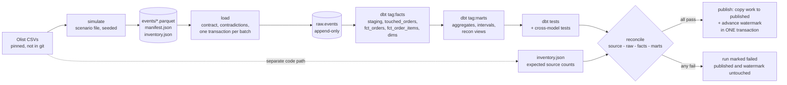
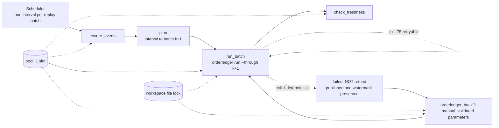

# Architecture

## Run lifecycle (`orderledger run`)

1. **Load** every pending batch up to the requested one. A file already loaded is skipped.
2. **dbt facts**: `touched_orders` = orders with an event whose `arrival_seq` is above the
   published **watermark** (plus a forced backfill window). Each touched order is rebuilt from its
   *full* event history, so the result never depends on batch boundaries.
3. **dbt marts**: aggregates restate the lookback window around the simulated checkpoint, the new
   dates of touched orders, and any forced window.
4. **Tests and reconciliation**: dbt generic and singular tests, then the reconciliation checks.
5. **Publish** (write-audit-publish): only if everything passed, `work.*` is copied to
   `published.*` and the watermark advances, in a single DuckDB transaction.

Every run, including failed ones, writes a row to `ctl.run_log` (step that failed, error,
counts, watermarks, duration). Reconciliation results are stored in `ctl.reconciliation`.

## Why a retry is safe

The watermark only moves at publish. A run that fails anywhere leaves it where it was, so the
retry recomputes exactly the same touched orders from the same raw history. Recomputation is by
key from full history (no deltas are ever added), so it is idempotent.

## Time

`checkpoint_date` is the simulated "now" of a run: the end of the last loaded batch. The
lookback is anchored to it, never to the wall clock, so results are reproducible. Real time is
used only for `published_at` and execution freshness.
See [late-data.md](late-data.md) for what the lookback does and does not guard against.

## Orchestration (Airflow, local)

Airflow 3.4.0 coordinates the same CLI; it adds scheduling, retries and visibility, not logic.
Details, scope and limits: [orchestration.md](orchestration.md). Recorded runs (synthetic fixture):
[orchestration-evidence.md](orchestration-evidence.md).

