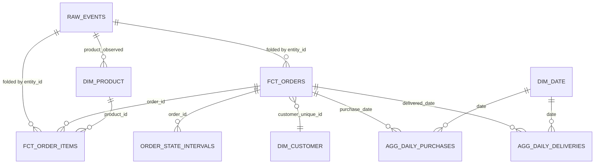

# Data model

| Table | Grain | Key | Notes |
|---|---|---|---|
| `raw.events` | one row per delivered event record | none (duplicates kept) | Append-only history with `batch_no`, `file_sha256`, `payload_hash` |
| `fct_orders` | one placed order | `order_id` | Lifecycle timestamps, `observed_status`, `is_deleted`, `is_sequence_valid`, item totals. Incremental, recomputed per touched order |
| `fct_order_items` | one order item | `item_key` = `order_id#item_no` | Current price after corrections. Incremental |
| `order_state_intervals` | one state of one order | `(order_id, state)` | Half-open intervals from recorded timestamps; coverage begins at purchase |
| `dim_customer` | one person | `customer_unique_id` | **Type 1.** See ADR-003 |
| `dim_product` | one product | `product_id` | Type 1; Olist has no attribute history |
| `dim_date` | one calendar day | `date_day` | Static |
| `agg_daily_purchases` | one purchase date with activity | `purchase_date` | Incremental, lookback window |
| `agg_daily_deliveries` | one delivery date with activity | `delivered_date` | Incremental, lookback window |

Surrogate keys are not used: Olist's natural keys are stable and unique, and an extra key would
add a mapping to maintain without answering any question the data raises.

Schemas: `raw`, `work` (dbt build area; incremental state lives here), `published` (what a
consumer reads), `ctl` (watermark, run log, reconciliation results).
